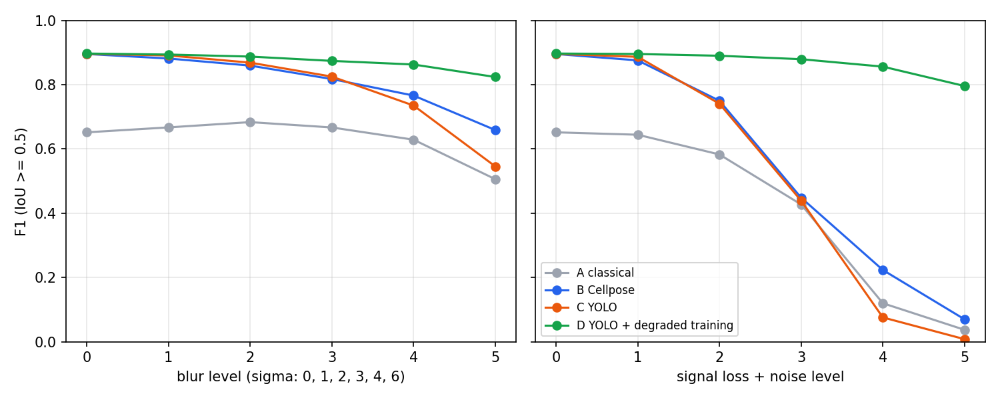
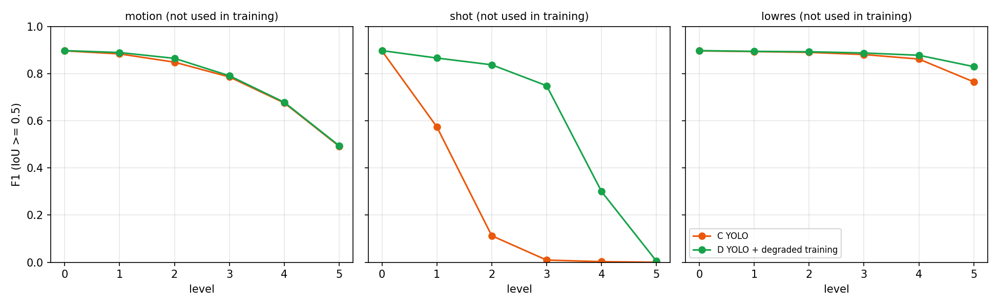

# Nuclei detection under image degradation

현미경 사진이 흐려지고 어두워질 때, 세포핵 검출 방법들은 얼마나, 어디서 무너질까요? 흐린 사진을 섞어 학습하면 버틸 수 있을까요?

깊은 조직을 찍은 영상은 빛이 산란되어 흐려지고 신호가 약해집니다. 이 실험은 그 상황을 단순한 수학적 열화로 흉내 내고, 네 가지 세포핵 검출 방법을 같은 기준으로 비교합니다.

## 결과 요약

평가용 사진 133장(세포핵 5,647개) 기준 F1 (IoU ≥ 0.5)

| 방법 | 원본 | 흐림 4단계 (시그마 4) | 신호 약화 + 잡음 4단계 |
|---|---|---|---|
| A 고전 영상처리 | 0.65 | 0.63 | 0.12 |
| B Cellpose | 0.90 | 0.77 | 0.22 |
| C YOLO | 0.90 | 0.74 | 0.08 |
| D YOLO + 열화 사진 학습 | 0.90 | 0.86 | 0.86 |

- 원본에서는 B, C, D가 모두 0.90으로 같았지만, 사진이 나빠질수록 C가 가장 가파르게 떨어졌습니다.
- 흐림보다 신호 약화 + 잡음이 훨씬 치명적이었습니다. 4단계에서 C의 F1은 흐림 0.74, 잡음 0.08입니다.
- 흐리거나 어두운 사본을 섞어 학습한 D는 원본 성능을 잃지 않고(0.90) 두 열화 모두에서 0.86을 유지했습니다.
- 해석: [가장 먼저 무너진 방법과 그 이유에 대한 가설 한 줄]

### 학습 때 보지 못한 열화 (노트북 11번)

D는 시험과 같은 방식의 열화(가우시안 흐림, 신호 약화 + 가우시안 잡음)로 학습했으므로, 처음 보는 세 가지 열화에서 C와 D를 다시 비교했습니다.

| 열화 | 단계 | C YOLO | D YOLO + 열화 학습 |
|---|---|---|---|
| 한 방향 번짐 (motion) | 4 | 0.68 | 0.68 |
| 빛 부족 잡음 (shot, 푸아송) | 1 | 0.57 | 0.87 |
| 빛 부족 잡음 (shot, 푸아송) | 2 | 0.11 | 0.84 |
| 빛 부족 잡음 (shot, 푸아송) | 4 | 0.00 | 0.30 |
| 해상도 저하 (lowres) | 4 | 0.86 | 0.88 |
| 해상도 저하 (lowres) | 5 | 0.77 | 0.83 |

- 가우시안 잡음으로 학습한 효과는 다른 종류의 잡음(푸아송)에도 크게 이어졌습니다.
- 가우시안 흐림으로 학습한 효과는 한 방향 번짐에는 거의 없었습니다(모든 단계에서 차이 0.02 이하).
- 해상도 저하에는 원래부터 강했고, D가 조금 더 나았습니다.

## 방법

| | 방법 | 학습 |
|---|---|---|
| A | Otsu 임계값 + watershed (고전 영상처리) | 없음 |
| B | Cellpose `nuclei` 모델 | 추가 학습 없이 그대로 사용 |
| C | YOLO11n 미세조정 | 이 데이터의 학습용 사진 |
| D | YOLO11n 미세조정 + 흐리거나 어둡게 만든 사본 추가 | 학습용 사진과 그 열화 사본 |

- **데이터:** 2018 Data Science Bowl 학습용 사진(BBBC038)에서 정답 마스크 오류를 고친 공개 버전 [lopuhin/kaggle-dsbowl-2018-dataset-fixes](https://github.com/lopuhin/kaggle-dsbowl-2018-dataset-fixes) (CC0). 사진 664장을 무작위로 학습 80%, 평가 20%로 나눴습니다.
- **채점:** 예측 상자와 정답 상자가 IoU 0.5 이상 겹치면 맞힌 것으로 보고, 헝가리안 매칭으로 짝지은 뒤 F1과 개수 오차를 계산합니다.
- **열화:** `blur`는 가우시안 흐림(시그마 0, 1, 2, 3, 4, 6)이고, `noise`는 신호를 배경 쪽으로 약하게 만든 뒤 잡음을 더한 것입니다.

## 한계

- 열화는 단순한 수학적 모형이며, 실제 조직의 광학 산란과 다릅니다.
- 무작위 분할이라 같은 실험에서 나온 비슷한 사진이 학습과 평가에 함께 들어갔을 수 있습니다.
- 평가용 사진의 대부분은 형광 사진이고, 명시야 사진은 5장뿐이라 종류별 비교는 참고용입니다.
- B는 추가 학습 없이 썼고 C, D는 이 데이터로 학습했으므로, 원본 점수의 순위보다 열화에 따른 하락 폭을 봐야 합니다.
- 위치(상자)만 채점했고, 세포핵 경계의 정확도는 채점하지 않았습니다.
- D는 시험과 같은 방식의 열화로 학습했으므로, 위 표의 D 결과는 "본 적 있는 열화"에서의 성능입니다. 처음 보는 열화는 노트북 11번에서 따로 확인했습니다.
- 빛 부족 잡음은 0~255 밝기 기준으로 빛 알갱이 수를 정해서, 어두운 형광 사진에서는 1단계부터 이미 매우 거칩니다.
- 잡음 실험은 색 채널마다 따로 잡음을 넣어 흑백 사진에 색 얼룩이 생겼습니다. 흑백으로 바꿔 처리하는 A·B와 달리 C는 이 얼룩을 그대로 보므로, 잡음에서의 B와 C 비교에는 이 차이가 섞여 있을 수 있습니다.

## 실행

`yim_nuclei_mini.ipynb`를 Google Colab에서 열고, 런타임 유형을 T4 GPU로 바꾼 뒤 위에서부터 실행합니다. 결과는 Google Drive의 `yim_nuclei` 폴더에 저장됩니다.

코드는 AI 도구(Claude)의 도움을 받아 작성했고, 실행과 결과 해석은 직접 했습니다.

## 배경

점자 표지판의 점자를 YOLO로 읽어 오류를 찾는 프로젝트에서 작은 물체를 빽빽하게 찾는 문제를 다뤘고, 같은 문제를 현미경 영상에 옮겨 본 실험입니다.
